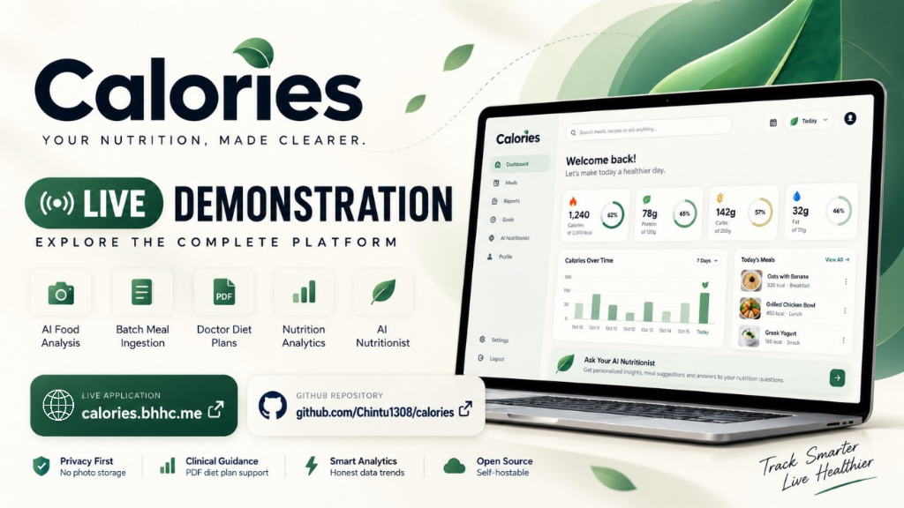

# Calories - Personal Nutrition & Calorie Tracking Platform
<div align="center">
  
</div>

> An Editorial Health-Tech platform pairing clinical precision, privacy-preserving AI assistance, and transparent nutritional analytics.

---

## Live Demonstration & Submission Links

- **Live Application:** [https://calories.bhhc.me](https://calories.bhhc.me) 
- **GitHub Repository:** [https://github.com/Chintu1308/calories](https://github.com/Chintu1308/calories)
- **Project Walkthrough & Video Demonstration:**

  <div align="center">
    <a href="https://youtu.be/dt71zDIMK8o" target="_blank" rel="noopener noreferrer">
      
    </a>
    <p><em><a href="https://youtu.be/dt71zDIMK8o" target="_blank" rel="noopener noreferrer">Watch the full project walkthrough video on YouTube</a></em></p>
  </div>

---

## Table of Contents
1. [Overview & Problem Statement](#overview--problem-statement)
2. [Key Innovations & Features](#key-innovations--features)
3. [Brand Identity & Design System](#brand-identity--design-system)
4. [Tech Stack & Architecture](#tech-stack--architecture)
5. [Project Structure](#project-structure)
6. [Local Setup & Installation Guide](#local-setup--installation-guide)
7. [Environment Configuration](#environment-configuration)
8. [API Documentation](#api-documentation)
9. [Automated Testing & Quality Suite](#automated-testing--quality-suite)
10. [Production Deployment](#production-deployment)
11. [Privacy & Security Invariants](#privacy--security-invariants)
12. [Contributors & Acknowledgements](#contributors--acknowledgements)

---

## Overview & Problem Statement

Most calorie counters and nutrition applications suffer from four critical friction points:
1. **Tedious, Fragile Logging:** Users are forced to manually enter ingredients item-by-item, or face rigid single-meal entry forms.
2. **Privacy Violations in AI Vision:** Uploaded food photos are often stored permanently on third-party servers.
3. **Disconnection from Medical Guidance:** Clinical diet charts and doctor prescriptions in PDF format sit unread in folders rather than actively guiding daily targets.
4. **Rigid Reporting:** Trends and reports break or distort when days are missed, lacking clear clinical export capabilities.

**Calories** solves these problems with an **Editorial Health-Tech** design language, ephemeral in-memory vision processing, batch tabular data ingestion, PDF medical prescription extraction, and dynamic trend analytics with filtered PDF reporting.

---

## Key Innovations & Features

### 1. AI Vision & Image Meal Logging
- **Header AI Scan:** Direct access from the top navigation bar to snap or upload a meal photo.
- **Ephemeral Processing:** Uploaded images are held strictly in temporary RAM buffers and analyzed via Google Gemini AI; **no raw photos are ever saved to disk or database**.
- **Calibrated Uncertainty:** Evaluates visual clarity and portion geometry; outputs calibrated confidence ratings (High >=80%, Moderate 60-79%, Low/Estimate <60%) with clear disclaimers for offline estimations.
- **User-in-the-Loop Review:** AI provides nutritional estimates (calories, protein, carbs, fat) and contextual fit analysis against remaining daily targets and user allergies, allowing full edits before saving.

### 2. AI Tabular & Multi-Meal Batch Ingestion
- **Multi-Date Logging:** Log an entire week or multiple meals at once across different dates.
- **Format Flexibility:** Paste Markdown tables, comma-separated values (CSV), tab-separated values (TSV), or plain text dated meal logs.
- **Dual Ingestion Paths:**
  - **Conversational Chat:** Paste any table directly into the AI Nutritionist Chat for automatic parsing and database sync.
  - **Batch Import Modal:** Open the dedicated *"AI Table / Batch Log"* modal on the Meal Journal page to preview, inspect, select/deselect entries, and bulk-commit to MongoDB.

### 3. Clinical Diet Plans & Doctor Prescriptions (PDF)
- **PDF Extraction:** Upload medical diet plans or doctor prescriptions in PDF format.
- **Gemini Medical Parsing:** Automatically extracts prescribed daily calorie targets, target macros (protein, carbs, fat), forbidden foods, recommended foods, and clinical notes.
- **Profile & Settings Management:** View, replace, or delete uploaded clinical instructions at any time via the Profile modal or Settings page.

### 4. Interactive Timeline Meal Journal
- **Chronological Flow:** View daily meals in a modern, responsive timeline with clear meal-category badges (Breakfast, Lunch, Dinner, Snacks).
- **Macro Breakdown & Edits:** View precise portion amounts, calculated calories, and macronutrient badges. Edit or delete any entry with a single click.

### 5. Dynamic Reports & Filtered Clinical PDF Export
- **Custom Time Horizons:** Filter analytics across **7 Days**, **14 Days**, or **30 Days**, grouped by **Day** or **Week**.
- **Current Day Indicator:** Clear visual marker highlighting the current day's progress.
- **Honest Absence:** Days without logs display zero without distorting historical trends or crashing the SVG chart.
- **Export Filtered PDF:** Generates a clinical-grade PDF nutrition report reflecting the active filter range and macro breakdown.

### 6. Interactive AI Nutritionist Assistant
- **Leaf-Branded Interface:** Distinctive Forest Green theme with custom leaf emblem.
- **Dynamic Context:** Aware of the user's live daily calorie balance, protein gap, allergies, and clinical diet prescriptions.
- **One-Click Hydration Logging:** Fast commands (e.g., *"Log 250ml water"*) to track daily hydration progress.

### 7. Goal Milestones & Post-Goal Re-Evaluation
- **Flexible Targets:** Set target weight, timeframe, and custom calorie/macro boundaries.
- **Completion Check:** Prompts users to record updated measurements upon reaching target dates or milestones to verify progress and establish new goals.

---

## Brand Identity & Design System

The platform strictly adheres to the **Editorial Health-Tech** color palette:

| Color Role | Hex Code | Purpose |
|---|---|---|
| **Ink Navy** | `#152238` | Deep editorial typography, headers, high-contrast containers |
| **Forest Green** | `#285B46` | Primary branding, action buttons, AI assistant accents |
| **Sage Green** | `#BFD8C2` | Progress rings, chart fills, secondary badges |
| **Warm Ivory** | `#FAF9F6` | Main background canvas, clean paper texture |
| **Pure White** | `#FFFFFF` | Card surfaces, interactive modals |
| **Soft Sand** | `#EDE5D8` | Dividers, neutral borders, category pill outlines |
| **Muted Slate** | `#6B7280` | Timestamps, units, secondary captions |
| **Amber Gold** | `#C88932` | Calorie budget threshold notices, warnings |
| **Error Crimson** | `#B84444` | Allergen collision alerts, input validation errors |

---

## Tech Stack & Architecture

- **Frontend (Client):**
  - React 19 (SPA) with TypeScript
  - Vite for instant Hot Module Replacement and production bundling
  - Tailwind CSS + Bespoke Editorial Health-Tech tokens
  - Lucide Icons & Custom SVG graphics
  - Supabase OAuth integration (Google Sign-In & Sign-Up)
- **Backend (Server):**
  - Node.js 22 LTS with Express 4
  - Modular TypeScript monolith (`routes`, `controllers`, `services`, `models`)
  - Mongoose ODM connecting to MongoDB Atlas
  - Supabase Auth / Bearer JWT for stateless multi-tenant authentication
  - Multer for in-memory multipart file handling (PDFs and food photos)
  - Google Gemini Generative AI SDK (`gemini-3.8-flash`, `gemini-3.5-flash-lite`, etc.)
- **Testing & Quality:**
  - Node 22 native test runner (`node:test`, `node:assert/strict`)
  - `oxlint` strict linter (0 errors, 0 warnings across all files)
  - `mongodb-memory-server` for automated isolated database integration testing

```
+--------------------------------------------------------+
|                   React 19 Client                      |
|   (Vite SPA - Dashboard - Timeline - Reports - AI Chat)|
+---------------------------+----------------------------+
                            | HTTPS / REST API
+---------------------------v----------------------------+
|                  Express 4 Server                      |
|   (Auth - Goals - Meals - Reports - AI Vision & Batch) |
+------+--------------------+--------------------+-------+
       |                    |                    |
+------v------+      +------v------+      +------v------+
|   MongoDB   |      |Google Gemini|      |  Supabase   |
|    Atlas    |      | Vision & AI |      | Auth /OAuth |
+-------------+      +-------------+      +-------------+
```

---

## Project Structure

```
calories/
|-- client/                      # React 19 + TypeScript frontend
|   |-- src/
|   |   |-- api/                 # Strongly-typed API client (apiClient.ts)
|   |   |-- components/          # Reusable UI components
|   |   |   |-- ai/              # NutritionChatAssistant & leaf branding
|   |   |   |-- auth/            # AuthOnboardingModal & AuthPage (Google OAuth)
|   |   |   |-- common/          # Header, Navigation, ErrorBoundary
|   |   |   |-- meals/           # BatchMealImportModal, MealFormModal, etc.
|   |   |   `-- ui/              # Badges, Buttons, Cards, Inputs, Modals
|   |   |-- pages/               # Dashboard, Meals, Reports, Goals, Settings
|   |   |-- types/               # TypeScript domain interfaces
|   |   `-- utils/               # trendCalculator.ts, exportPdf.ts, etc.
|   |-- public/                  # Static assets & brand media
|   `-- package.json
|
|-- server/                      # Node.js 22 + Express backend
|   |-- src/
|   |   |-- config/              # Environment schema & database connection
|   |   |-- controllers/         # Request handling & HTTP envelope format
|   |   |-- models/              # User, Meal, Goal, DietPlan Mongoose schemas
|   |   |-- routes/              # Modular routing (auth, goals, meals, ai)
|   |   |-- services/            # aiBatchTableService, aiVisionService, etc.
|   |   `-- middlewares/         # authMiddleware, uploadMiddleware, errors
|   |-- src/app.test.ts          # Automated integration test suite
|   `-- package.json
|
|-- docs/                        # Architecture, API & Progress documentation
|-- .env.example                 # Root environment variables template
|-- render.yaml                  # Render Infrastructure-as-Code blueprint
`-- package.json                 # Top-level workspace scripts
```

---

## Local Setup & Installation Guide

### Prerequisites
- **Node.js:** v22.14.0 or higher
- **npm:** 10.9.0 or higher
- **Git:** Installed and available on your PATH
- **MongoDB:** A free [MongoDB Atlas](https://www.mongodb.com/atlas) cluster connection string or a local MongoDB instance

---

### Step 1: Clone the Repository
```bash
git clone https://github.com/Chintu1308/calories.git
cd calories
```

---

### Step 2: Install Dependencies
Run the following commands to install dependencies for both workspace projects:
```bash
# Install server dependencies
npm install --prefix server

# Install client dependencies
npm install --prefix client
```

---

### Step 3: Configure Environment Variables

1. Copy the example file into `server/.env`:
```bash
# On Linux / macOS / Git Bash:
cp .env.example server/.env

# On Windows PowerShell:
Copy-Item .env.example server/.env
```

2. Open `server/.env` and update the required values:
```env
PORT=5000
NODE_ENV=development
CLIENT_ORIGIN=http://localhost:5173

# Connect to your MongoDB Atlas cluster or local instance
MONGODB_URI=mongodb+srv://<username>:<password>@cluster0.mongodb.net/calories?retryWrites=true&w=majority

# Strong random secret for signing JWTs (minimum 32 characters)
JWT_SECRET=calories_super_secure_jwt_secret_token_key_2026_xyz

# Google Gemini API Key for food vision, tabular ingestion, and chat
GEMINI_API_KEY=your_gemini_api_key_here

# Optional: Supabase configuration (if utilizing cloud auth & Google OAuth)
SUPABASE_URL=https://your-project.supabase.co
SUPABASE_ANON_KEY=your_anon_key
SUPABASE_SERVICE_ROLE_KEY=your_service_role_key
```

3. *(Optional)* Configure `client/.env` if deploying to separate hosting:
```env
# Leave empty for local development (Vite proxies /api to localhost:5000)
VITE_API_URL=
```

---

### Step 4: Run Development Servers

Open two terminal windows:

**Terminal 1 - Backend API:**
```bash
npm run dev:server
# Server starts on http://localhost:5000
```

**Terminal 2 - Frontend Application:**
```bash
npm run dev:client
# Frontend opens at http://localhost:5173
```

Visit **`http://localhost:5173`** in your browser.

---

## Environment Configuration

| Variable | Required | Default | Description |
|---|---|---|---|
| `PORT` | No | `5000` | Port on which the Express server listens |
| `NODE_ENV` | No | `development` | `development`, `production`, or `test` |
| `CLIENT_ORIGIN` | No | `http://localhost:5173` | Allowed CORS origin(s) |
| `MONGODB_URI` | **Yes** | - | MongoDB Atlas connection string |
| `JWT_SECRET` | **Yes** | - | HMAC-SHA256 secret (32+ characters) |
| `GEMINI_API_KEY` | **Yes** | - | Google Gemini API key for vision, batch table, and chat |
| `SUPABASE_URL` | No | - | Supabase project URL |
| `SUPABASE_ANON_KEY` | No | - | Supabase public anonymous API key |
| `SUPABASE_SERVICE_ROLE_KEY` | No | - | Supabase administrative service role key |

---

## API Documentation

Base URL: `/api/v1`

### Authentication & User Profile
- `POST /api/v1/auth/register` - Create a new account with onboarding metrics (height, weight, allergies, supplements).
- `POST /api/v1/auth/login` - Authenticate and receive a Bearer JWT.
- `GET /api/v1/auth/google/url` - Generate Supabase Google OAuth authorization URL.
- `GET /api/v1/auth/me` - Retrieve the current authenticated user's profile and active settings.
- `PUT /api/v1/auth/profile` - Update user profile details, measurements, and supplements.

### Nutrition Goals
- `GET /api/v1/goals` - Retrieve active nutrition goals (calories, protein, carbs, fat, target weight).
- `PUT /api/v1/goals` - Idempotently upsert active goals.
- `POST /api/v1/goals` - Archive the prior goal and establish a new active milestone.
- `GET /api/v1/goals/history` - Retrieve historical goals chronologically.

### Meals & Timeline Journal
- `GET /api/v1/meals` - Paginated meal log with date, mealType, and text search filters.
- `POST /api/v1/meals` - Record a new meal entry.
- `GET /api/v1/meals/:id` - Fetch details for a specific meal.
- `PATCH /api/v1/meals/:id` - Update an existing meal entry.
- `DELETE /api/v1/meals/:id` - Delete a meal entry.

### AI Capabilities
- `POST /api/v1/ai/extract` - Multipart image upload for vision extraction and health compliance analysis (proposal only; uncommitted).
- `POST /api/v1/ai/batch-extract-table` - Ingest Markdown tables, CSV, TSV, or multi-date text logs with optional automatic MongoDB commit.
- `POST /api/v1/ai/chat` - Conversational nutritionist assistant with live macro context, hydration commands, and table parsing.
- `POST /api/v1/ai/upload-diet-pdf` - Upload medical prescription / diet plan PDF for automated extraction of targets, macros, and restrictions.
- `GET /api/v1/ai/diet-instructions` - Retrieve active clinical diet instructions for the authenticated user.
- `DELETE /api/v1/ai/diet-instructions` - Remove active clinical diet instructions.

### Reports & Analytics
- `GET /api/v1/reports/weekly-calories` - Dense calorie trajectory compared against target lines.
- `GET /api/v1/reports/macros` - Macronutrient totals and Atwater energy percentage distribution.
- `GET /api/v1/reports/micronutrients` - Honest absence micronutrient aggregation.
- `GET /api/v1/reports/goals` - Actual averages versus target goal compliance rate.

---

## Automated Testing & Quality Suite

The platform includes a zero-warning quality suite:

```bash
# 1. Run strict oxlint check on both frontend and backend (0 warnings, 0 errors)
npm run lint

# 2. Run TypeScript strict typecheck across client and server
npm run typecheck

# 3. Execute backend integration test suite (64 automated tests)
npm run test:server

# 4. Compile and verify production build artifacts
npm run build
```

---

## Production Deployment

### 1. Render (`render.yaml`)
This repository contains a unified `render.yaml` blueprint defining:
- A Node.js web service for `server`
- A static site for `client`

### 2. Vercel / Netlify
The `client/vercel.json` provides rewrite rules routing all requests to `index.html` for client-side routing.

### 3. Docker Container
A multi-stage `Dockerfile` is provided in the repository root for self-hosted container deployments.

---

## Privacy & Security Invariants

- **Stateless Tenant Isolation:** Every request is authenticated via Bearer JWT. All database operations strictly filter by `req.user.userId`.
- **Ephemeral Vision Buffers:** Food photos uploaded for AI analysis are processed exclusively in RAM memory buffers and immediately dropped. **No photos are stored on disk or in the database.**
- **User Confirmation Required:** AI extraction returns uncommitted proposals only. No meal is committed to the database without explicit user confirmation.
- **Honest Nutritional Absence:** Missing micronutrient data is omitted rather than defaulted to zero, avoiding deceptive nutrition reporting.

---

## Contributors & Acknowledgements
- **Author:** [Bongu Hari Hara Charan](https://github.com/Chintu1308)
- **Design Philosophy:** Premium Editorial Health-Tech
- **Built for:** Typeface Calorie Tracking Platform Submission

---

<div align="center">
  
</div>
