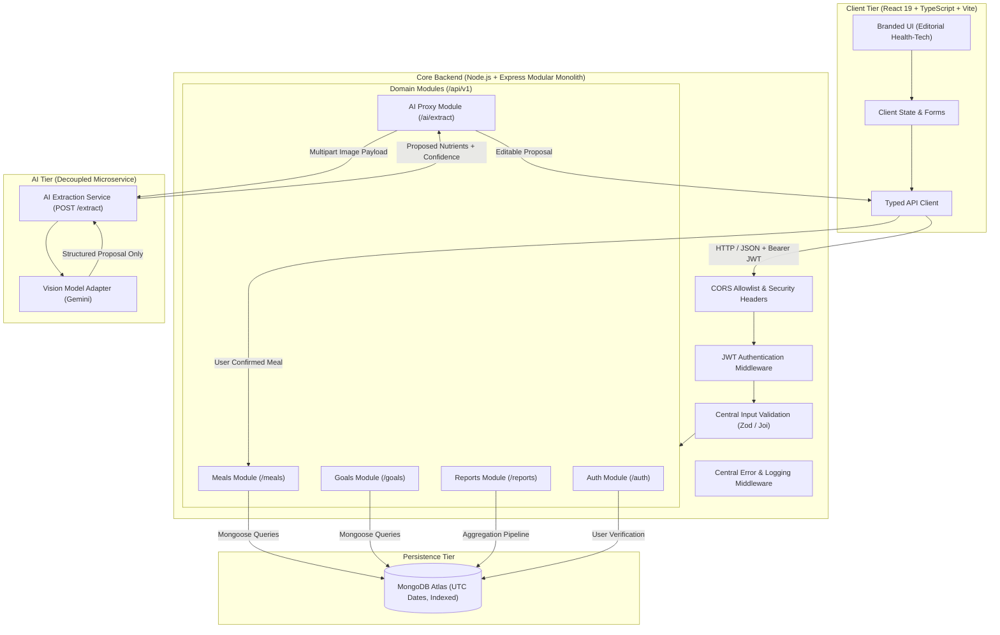

# Calories Architecture Specification

## 1. System Overview
Calories is an editorial-grade personal nutrition and calorie tracking platform designed to provide transparent, accurate, and privacy-conscious nutrition tracking.

The system is organized as a three-tier architecture with a decoupled AI extraction microservice:
1. **Frontend Client (`client/`):** React 19 + TypeScript + Vite Single-Page Application (SPA) styled using a custom token system based on the Calories brand palette.
2. **Core Backend (`server/`):** Node.js + Express + TypeScript modular monolith exposing REST endpoints under `/api/v1`.
3. **AI Extraction Service (`ai-service/`):** Dedicated microservice boundary for multivariable image processing (nutrition label OCR / plate food recognition) using Google Gemini or alternative vision models. The AI service holds no database credentials and cannot write meals directly.
4. **Database Tier:** MongoDB (Atlas Free tier) with explicit schema validation, UTC timestamps, and compound indexing for multi-tenant data isolation.

## 2. Architecture Diagram

## 3. Core Architectural Boundaries & Principles

### A. Modular Monolith Backend
All primary domain logic (Authentication, Goals, Meals, Reports) resides within the same Express application under `server/src/modules/`. This design minimizes deployment complexity, eliminates distributed transaction overhead, and provides single-process performance while maintaining clean directory boundaries for eventual microservice extraction if needed.

### B. AI Microservice Boundary
- The AI service performs stateless image analysis only.
- The AI service has **no database credentials** and cannot commit records directly to the database.
- AI responses represent a **proposal only** (including estimated calories, macros, quantity, confidence rating, and warnings).
- The proposal must be reviewed and editable by the end user before being saved to MongoDB via the standard `POST /api/v1/meals` endpoint.

### C. Authentication & Tenant Isolation
- Every request to private endpoints must bear a valid JWT.
- User identity (`userId`) is derived **exclusively** from the verified JWT payload on the server.
- The server **never** trusts `userId` supplied in the request body, query parameters, or URL path.
- All MongoDB queries filter on `{ userId: req.user.id }` to guarantee complete multi-tenant data isolation.

### D. Timezone & Timestamp Standard
- All stored dates (`eatenAt`, `createdAt`, `updatedAt`) are stored strictly in ISO 8601 UTC format.
- Timezone offsets are communicated from the client via headers (`X-Timezone`) or query parameters to support accurate localized grouping for daily and weekly reports.

### E. Workspace Scripts & Task Orchestration
The monorepo uses root `package.json` scripts (`--prefix client`, `--prefix server`) to orchestrate tasks without hoisting client browser dependencies and Node backend dependencies into a shared conflict-prone root node_modules directory.
